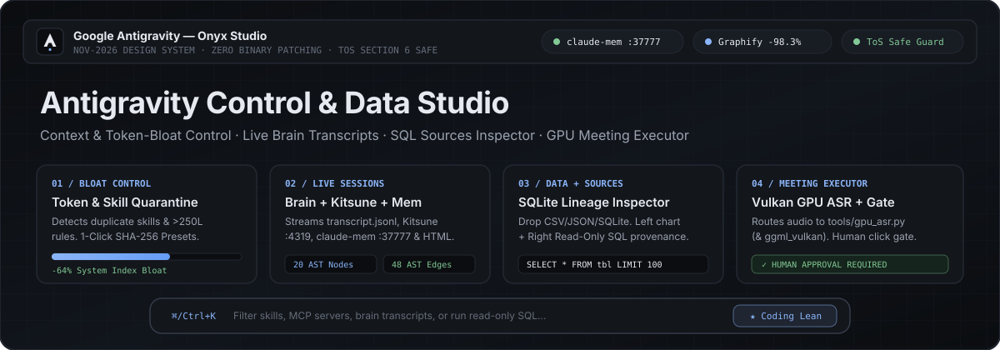

<div align="center">


# Google Antigravity: Dashboards, Context & Motion Studio

**[English](./README.md) | [简体中文](./docs/README.zh-CN.md) | [Português](./docs/README.pt-BR.md)**

**[Live Interactive GitHub Pages Showcase → https://santanaluiz181-cell.github.io/antigravity-dashboard/](https://santanaluiz181-cell.github.io/antigravity-dashboard/)**

Build live local dashboards, quarantine context bloat, inspect read-only SQLite sources, and gate GPU-transcribed meeting actions inside the official `antigravity.google` design system.

<br />



</div>

---

## Built as Code, Grounded in Local Sources

Inspired by the workflow of **Claude Dashboards & Motion** (`claude.com/resources/articles/dashboards-and-motion`) and **Claude Code Dashboards**, rebuilt natively in the visual language, typography, and cursor physics of **`https://antigravity.google/`**.

Every metric, chart, and staged MCP payload exposes its exact Windows file path and read-only SQLite query so you can verify numbers before taking action.

* **Zero Binary Patching (ToS Section 6 Safe)**: Runs as a standalone local web studio (`Hono` on `:4320` + `Vite / React 19` on `:5175`). It never modifies `~/.gemini/bin/agy.exe` or any `.asar` bundle (`assertNeverTouchesOfficialBinaries()` in [server/paths.ts](./server/paths.ts)).

---

## Visual System Extracted via `/REA` from `antigravity.google`

| Token / System | Extracted Production Value | Purpose in Studio |
| :--- | :--- | :--- |
| **Display & UI Font** | `Google Sans Flex` (`ROND 40, opsz 8..144`) | Primary headings, metric cards, and interactive stage controls. |
| **Code & SQL Font** | `Google Sans Code` (`wght 400..700`) | File paths, `transcript.jsonl` logs, token counters, and SQL queries. |
| **Iconography** | `Google Symbols` (`ROND 50, opsz 24`) | Native Google symbol font replacing generic third-party icon packs. |
| **Dark Surface Palette** | `--palette-grey-1200` (`#121317`), `#18191d`, `#212226` | Primary dark workspace canvas and elevated cards. |
| **Light Editorial Palette** | `--palette-grey-10` (`#F8F9FC`), `--palette-grey-0` (`#FFFFFF`) | High-contrast light theme toggleable from the top bar. |
| **Capsule Particle Physics** | Port of `MainParticlesComponent.Cr9vcqqS.js` | Interactive Poisson-disk capsule field (`#7189ff`, `#3279f9`, `#f84242`, `#ffcf03`) that rotates toward the cursor with a 2% frame lerp gravitational ring. |

---

## Four Interactive Stages

### Stage 01: Context & Token-Bloat Control
When `~/.gemini/config/skills` and plugin folders (`SuperAntigravityTJTO`, `science`) contain duplicate skills or 250+ line rule files, the system prompt index overflows its token budget and silently drops core subagents (`browser`, `research`, `super-render`, `ultimate-research`).
* Scans global skills, plugin skills, builtin skills, `GEMINI.md`, `AGENTS.md`, and `mcp_config.json`.
* Flags prompts over `250 lines` and highlights duplicate skill collisions.
* **1-Click Atomic Presets** (`Coding Lean`, `Frontend Craft`, `Journalism & TJTO`, `Video / B-Roll`, `Full Restore`): snapshots `mcp_config.json` with SHA-256 verification before moving redundant skills into `backups/quarantine_skills/`.

### Stage 02: Live Brain Sessions, Kitsune & Billion-Context
* Streams live trajectories from `~/.gemini/antigravity/brain/<id>/.system_generated/logs/transcript.jsonl`.
* Probes local daemons: **Kitsune Router** (`127.0.0.1:4319`), **claude-mem** (`127.0.0.1:37777`), and **MJ Notch Companion** (`127.0.0.1:49211`).
* Reads `.graphify.json` (`Graphify + PonyTail` AST index: 20 files, 48 edges) and `PROJECT_MAP.md` (`Cartographer` static symbol map: `-98.3%` token footprint vs blind scanning).
* Sandboxed previewer for local `/generative_ui` HTML artifacts.

### Stage 03: Live Dashboards & Read-Only SQL Sources Inspector
* Drag-and-drop any `.csv` or `.json` file to mount a live table inside Node v26 native `node:sqlite` (`DatabaseSync`).
* **Left Stage**: Interactive bar visualization and data table.
* **Right Sources Pane**: Displays the verified file path, inferred schema, deterministic transformation steps, and a live SQL editor guarded by `assertReadOnlySelectSql()` (only single-statement `SELECT` and `WITH` queries are allowed).

### Stage 04: Knowledge Hub & GPU Meeting/Media Vault
* Ingests **Instagram Reels**, **YouTube URLs**, or local audio/video files.
* Executes `watch_video.py --gpu auto --ocr-dml --transcribe` + `gpu_asr.py` (`ggml_vulkan` acceleration on AMD RX 6600, NVIDIA or Intel Arc).
* Extracts word-level transcriptions, key video OCR visual text highlights, and discovers cross-knowledge semantic connections (edges linking Reels, YouTube guides, and team meetings sharing concepts).
* **Mandatory Human Approval Gate**: staged MCP actions stay locked in `PENDING_HUMAN_APPROVAL` until you explicitly click **Approve & Trigger MCP**.

### Stage 05: 2.5D Gaussian Splat Studio & Antigravity Motion
* High-performance dual-backend 2.5D Gaussian Splat generator powered by `engines/gaussian-splat-25d/train.py`.
* GPU-accelerated depth estimation & splat rasterization using **ROCm gfx1032** (via native AMD PyTorch) or **Vulkan wgpu** with automatic hardware detection (CPU/DirectML execution is strictly banned to prevent system lag).
* Live WebGL2 viewer with orbital controls and direct export to **Remotion** Z-sandwich video templates (`remotion_gaussian_splat_25d.tsx`).

---

## Ecosystem Supercharge: Kitsune Router (Multi-LLM & Anti-429)

This dashboard connects natively with **[Kitsune Router](https://github.com/santanaluiz181-cell/kitsune-router)**, an ultra-fast local MCP bridge & prompt dispatcher:

* **Zero-Cost Multi-Account Pooling**: Rotates multiple Google AI Studio keys, Google OAuth sessions, NVIDIA Nemotron, and local Ollama models.
* **Intelligent 429 Failover**: Automatically switches providers if one hits a rate limit or runs out of free quota.
* **PrivacyGuard**: Keeps sensitive judicial or enterprise code 100% on local offline models (`ollama/qwen2.5-coder:14b`), while routing public web research and heavy coding to `gemini-3.8-pro`, `claude-sonnet-4-5`, or `deepseek-r1`.
* **Live Compact Pill HUD**: Floating real-time telemetry badge (`http://127.0.0.1:4319/?mode=pill`) that displays mascot animations, routing status, and token savings.

👉 **Get Kitsune Router**: Clone and launch the official repository at **[https://github.com/santanaluiz181-cell/kitsune-router](https://github.com/santanaluiz181-cell/kitsune-router)**.

---

## Repository Structure

```text
Antigravity Dashboard/
├── public/
│   └── logo.svg                             # Vectorized easel + 4-color ribbon brand mark
├── docs/
│   ├── README.zh-CN.md                      # Simplified Mandarin documentation
│   ├── README.pt-BR.md                      # Portuguese documentation
│   └── assets/
│       ├── logo.svg                         # Vector brand mark
│       ├── antigravity-hero.svg             # Showcase stage vector graphic
│       └── architecture-overview.svg        # System dataflow diagram
├── server/
│   ├── index.ts                             # Hono API server (127.0.0.1:4320)
│   ├── paths.ts                             # Windows path resolver + ToS binary guard
│   └── services/
│       ├── tokenScanner.ts                  # Token & duplicate skill scanner
│       ├── profileManager.ts                # Atomic quarantine & preset manager
│       ├── transcriptReader.ts              # Brain JSONL reader + Kitsune/claude-mem probes
│       ├── sqliteInspector.ts               # Native node:sqlite engine + read-only SQL guard
│       └── meetingPipeline.ts               # Vulkan GPU ASR bridge + human approval queue
├── src/
│   ├── App.tsx                              # Interactive hero + 4-stage workbench
│   ├── styles/onyx.css                      # Official antigravity.google CSS tokens
│   └── components/
│       ├── AntigravityLogo.tsx              # Vector brand mark component
│       ├── AntigravityParticlesCanvas.tsx   # Mouse-reactive capsule particle simulation
│       ├── TopTelemetryBar.tsx              # Context budget bar + Dark/Light switch
│       ├── BottomCommandBar.tsx             # Floating pill dock & filter input
│       └── Module1..4*.tsx                  # Stage views
└── tests/
    └── dashboard.test.ts                    # Vitest suite (6/6 security & mutation checks)
```

---

## Quickstart

Requires **Node.js v22.5+** (verified on `v26.13.1` with built-in `node:sqlite`) and **Python 3.12+** (optional, for `gpu_asr.py` Vulkan GPU transcription).

```powershell
# 1. Install dependencies
npm install

# 2. Run Vitest security & mutation suite
npm test

# 3. Start Backend API (:4320) + Frontend Studio (:5175)
npm run dev
```

Open `http://localhost:5175` in your browser.
