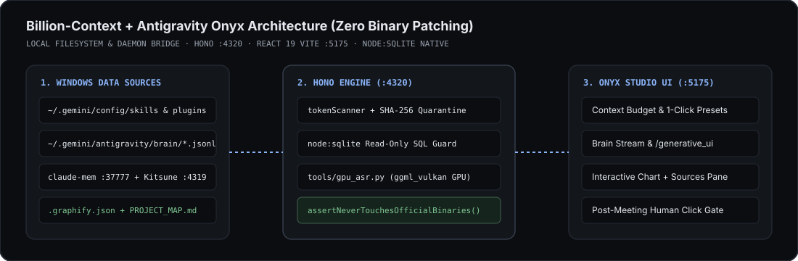

<div align="center">


<br />

# Google Antigravity — Control & Data Studio (`Onyx Nov-2026`)

**Context & Token-Bloat Control Center · Live Brain & Kitsune Bridge · SQLite Sources Inspector · GPU Post-Meeting Executor**

[-81C995?style=for-the-badge& labelColor=13161B)](#segurança-tos-section-6-zero-binary-patching)
[](#arquitetura--stack)
[](#ecossistema-billion-context-claude-mem--graphify--cartographer)
[-81C995?style=for-the-badge&labelColor=13161B)](#testes--verificação-uncle-bob-gate)

</div>

---

## Visão Geral (O Que É e Por Que Existe)

O **Antigravity Dashboard** é uma estação web local standalone desenhada estritamente sob o **Design System Google Antigravity Nov-2026 (`Onyx #0B0D10 / #13161B / #232832` + Material Design 3 Dark + Google Sans / JetBrains Mono)**.

Ele combina quatro fluxos críticos em uma única superfície local:
1. **Context & Token-Bloat Control Center** *(inspirado em Claude Code Dashboards)*: Escaneia `~/.gemini/config/skills`, plugins (`SuperAntigravityTJTO`, `science`), `GEMINI.md`, `AGENTS.md` e `mcp_config.json`, detectando **skills duplicadas** e **prompts acima de 250 linhas** que estouram o orçamento de contexto e expulsam subagentes essenciais (`browser`, `research`, `super-render`, `ultimate-research`).
2. **Live Sessions, Remote & Kitsune Bridge**: Stream em tempo real de `~/.gemini/antigravity/brain/<id>/.system_generated/logs/transcript.jsonl`, telemetria do **Kitsune Router (`:4319`)**, **claude-mem (`:37777`)**, **MJ Notch Companion (`:49211`)** e previewer sandbox para artefatos `/generative_ui`.
3. **Interactive Data Dashboard + Sources Pane** *(inspirado em Anthropic Claude Dashboards)*: Ingestão drag-and-drop de `.csv`, `.json` e `.sqlite` via motor nativo `node:sqlite` (`DatabaseSync`) com gráfico interativo à esquerda e inspetor transparente de linhagem SQL Read-Only (`SELECT`/`WITH`) à direita.
4. **Post-Meeting Executor MVP** *(alternativa limpa ao Claude Meetings sem bot WebRTC frágil)*: Recebe áudio ou notas de reunião, roteia para transcrição acelerada em GPU (`tools/gpu_asr.py` com `ggml_vulkan`), extrai Resumo Executivo, Decisões e Tarefas, e trava qualquer execução de ferramenta MCP atrás de um **Portão Obrigatório de Clique Humano (`PENDING_HUMAN_APPROVAL`)**.

---

## Arquitetura Visual & Fluxo de Dados

<div align="center">
  
</div>

```mermaid
flowchart LR
  subgraph WIN["Windows Local Sources (~/.gemini)"]
    SK["config/skills + plugins/*/skills"]
    RL["GEMINI.md + AGENTS.md"]
    MCP["antigravity/mcp_config.json"]
    BR["brain/<id>/transcript.jsonl"]
    DB["conversation_summaries.db"]
  end

  subgraph CTX["Billion-Context & Daemons"]
    CM["claude-mem Worker (:37777)"]
    GR[".graphify.json (AST Graph)"]
    CT["PROJECT_MAP.md (-98.3% Tokens)"]
    KR["Kitsune Router (:4319)"]
    GPU["tools/gpu_asr.py (ggml_vulkan)"]
  end

  subgraph API["Hono Local Backend (:4320)"]
    GUARD["assertNeverTouchesOfficialBinaries()"]
    SCAN["tokenScanner + SHA-256 Quarantine"]
    SQL["node:sqlite Read-Only Inspector"]
    MTG["Meeting Extractor + Human Gate"]
  end

  subgraph UI["Onyx Studio Frontend (:5175)"]
    M1["01. Bloat Control & 1-Click Presets"]
    M2["02. Brain Stream & /generative_ui"]
    M3["03. Interactive Chart + Sources SQL"]
    M4["04. Post-Meeting Human Click Gate"]
  end

  SK & RL & MCP --> SCAN --> M1
  BR & CM & GR & CT & KR --> M2
  DB --> SQL --> M3
  GPU --> MTG --> M4
  GUARD -. Protects agy.exe .-> SCAN
```

---

## Estética Google Antigravity (`Nov-2026 Onyx Spec`)

| Token Visual | Valor Hex / Regra | Aplicação no Dashboard |
| :--- | :--- | :--- |
| **`--agy-canvas`** | `#0B0D10` | Superfície primária ultra-escura (zero fadiga visual, zero neon genérico). |
| **`--agy-surface`** | `#13161B` | Cards elevados Material Design 3 com contraste controlado. |
| **`--agy-border`** | `#232832` (`1px solid`) | Hairline borders sutis separando painéis de telemetria e tabelas. |
| **`--agy-accent`** | `#8AB4F8` (Google Blue Dark) | Indicadores de foco, barras de orçamento de tokens e pílulas ativas. |
| **`--agy-ok / warn / danger`** | `#81C995` / `#F29900` / `#F28B82` | Semântica oficial Google Dark para integridade SHA-256, alertas de colisão e bloqueios. |
| **Typography** | `Google Sans`, `Inter`, `JetBrains Mono` | Números tabulares (`tnum`) para contagem de tokens e monoespaçada para SQL/caminhos. |
| **Bottom Command Bar** | Ancorada na base (`Ctrl+K` / Filtro) | Navegação rápida entre os 4 módulos + ativação em 1 clique do preset `Coding Lean`. |

---

## Ecossistema Billion-Context (`claude-mem` + `Graphify` + `Cartographer`)

O projeto opera integrado aos 3 motores de economia extrema de contexto:
1. **`claude-mem` (`http://127.0.0.1:37777`)**: Daemon ativo em segundo plano persistindo memórias estruturadas (`save_memory`), listas de estado (`work_state_write`) e corpus semântico (`antigravity-dashboard-corpus`).
2. **`Graphify + PonyTail` (`.graphify.json`)**: Grafo estrutural AST indexando arquivos e arestas de dependência para leitura fatiada (`StartLine`/`EndLine`) sem leituras cegas.
3. **`Cartographer` (`PROJECT_MAP.md`)**: Mapa hierárquico estático do repositório que reduz a pegada de descoberta em **-98.3%** (`75.013 tokens` economizados por sessão).

---

## Segurança ToS Section 6 (`Zero Binary Patching`)

Diferente de modificadores invasivos que alteram binários `.asar` ou executáveis e causam bloqueios de conta, o **Antigravity Dashboard** possui uma trava em nível de código (`assertNeverTouchesOfficialBinaries` em `server/paths.ts`):
- **Jamais toca** em `~/.gemini/bin/agy.exe` ou qualquer `.exe`, `.dll` ou `.asar`.
- Opera exclusivamente sobre arquivos de configuração documentados e pastas de skills do usuário, criando snapshots verificados por **SHA-256** em `backups/` antes de qualquer preset.

---

## Como Executar Localmente

```powershell
# 1. Instalar dependências
npm install

# 2. Rodar suíte de verificação (Vitest — 6/6 testes com asserções negativas de segurança)
npm test

# 3. Iniciar Backend (:4320) + Frontend Onyx (:5175)
npm run dev
```

Acesse **`http://localhost:5175`** no navegador.

---

## Estrutura de Diretórios

```text
Antigravity Dashboard/
├── docs/assets/                   # Banners SVG vetoriais (Onyx Hero + Arquitetura)
├── backups/                       # Snapshots SHA-256 de mcp_config.json e quarentena reversível
├── server/
│   ├── index.ts                   # Servidor Hono (porta 4320)
│   ├── paths.ts                   # Guardas ToS Section 6 e resolução de caminhos Windows
│   └── services/
│       ├── tokenScanner.ts        # Detector de skills duplicadas e prompts >250 linhas
│       ├── profileManager.ts      # Presets de 1 clique (Coding Lean, Frontend, TJTO, Video, Restore)
│       ├── transcriptReader.ts    # Stream de brain/<id>/transcript.jsonl + Kitsune :4319 + claude-mem :37777
│       ├── sqliteInspector.ts     # Motor nativo node:sqlite + guarda Read-Only SELECT/WITH
│       └── meetingPipeline.ts     # Ponte GPU Vulkan (tools/gpu_asr.py) + Human Approval Gate
├── src/
│   ├── App.tsx                    # Shell principal Onyx + barra inferior M3
│   ├── styles/onyx.css            # Tokens Google Antigravity Nov-2026 (#0B0D10 / #13161B / #232832)
│   └── components/                # TopTelemetryBar, BottomCommandBar e Módulos 1 a 4
├── tests/
│   └── dashboard.test.ts          # Suíte Vitest (Uncle Bob Gate: testes positivos, negativos e mutação)
├── .graphify.json                 # Grafo AST gerado pelo Graphify + PonyTail
├── PROJECT_MAP.md                 # Mapa estrutural gerado pelo Cartographer (-98.3% tokens)
└── organizer.md                   # Checkpoint de restauração Auto-Organizer
```
