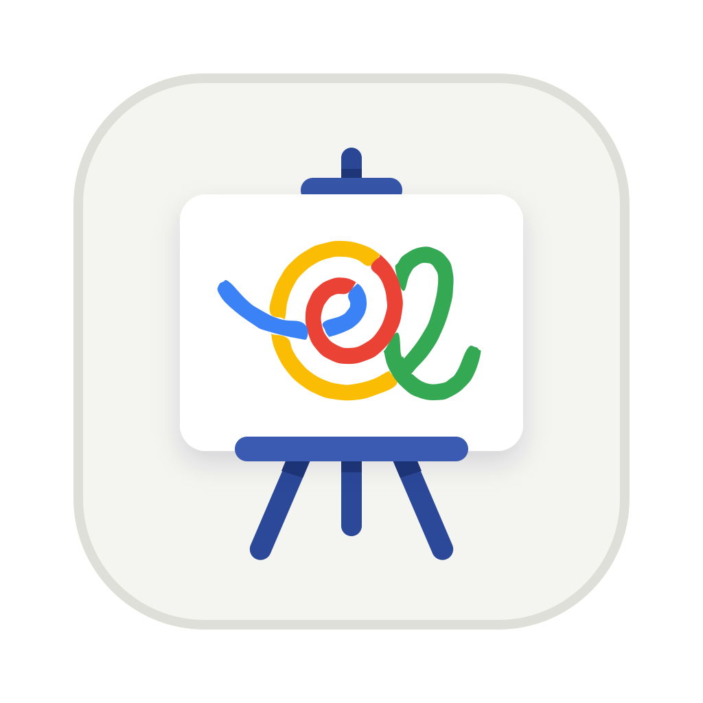
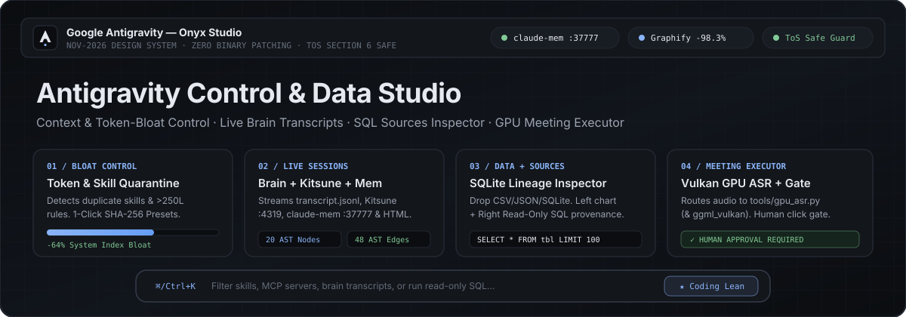

<div align="center">



# Google Antigravity: Dashboards, Context & Motion Studio

**[English](../README.md) | [简体中文](./README.zh-CN.md) | [Português](./README.pt-BR.md)**

**[Página Interativa no GitHub Pages → https://santanaluiz181-cell.github.io/antigravity-dashboard/](https://santanaluiz181-cell.github.io/antigravity-dashboard/)**

Construa dashboards locais vivos, isole o bloat de contexto, inspecione fontes SQLite Read-Only e aprove ações de reunião transcritas via GPU dentro do sistema visual oficial do `antigravity.google`.

<br />



</div>

---

## Construído em Código, Ancorado em Fontes Reais

Inspirado pelo fluxo do **Claude Dashboards & Motion** (`claude.com/resources/articles/dashboards-and-motion`) e do **Claude Code Dashboards**, reconstruído nativamente com a tipografia, paleta de superfícies e física de partículas reativas ao mouse extraídas via `/REA` do **`https://antigravity.google/`**.

Cada métrica, gráfico e ação MCP expõe o caminho exato no Windows e a query SQLite Read-Only que originou os números.

* **Zero Modificação de Binários (Seguro sob ToS Seção 6)**: Opera como estação web local externa (`Hono` em `:4320` + `Vite / React 19` em `:5175`). Jamais modifica `~/.gemini/bin/agy.exe` ou pacotes `.asar` (`assertNeverTouchesOfficialBinaries()` em [server/paths.ts](../server/paths.ts)).

---

## Sistema Visual Extraído via `/REA` de `antigravity.google`

* **Fontes Oficiais (`fonts.googleapis.com`)**: `Google Sans Flex` (títulos e controles), `Google Sans Code` (caminhos, JSONL e SQL) e `Google Symbols` (ícones vetoriais nativos do Google).
* **Paleta Oficial (`BaseLayout.DscqpsAU.css`)**: Modo Escuro `--palette-grey-1200` (`#121317`), `#18191d`, `#212226` e Modo Claro Editorial `--palette-grey-10` (`#F8F9FC`) / `#FFFFFF`, alternáveis no topo da página.
* **Física de Micro-Cápsulas Reativas ao Mouse (`MainParticlesComponent.Cr9vcqqS.js`)**: Campo de micro-cápsulas distribuídas por Poisson-disk (`#7189ff`, `#3279f9`, `#f84242`, `#ffcf03`) que rotacionam em direção ao cursor com inércia elástica de `2%` por quadro.

---

## Execução Rápida

```powershell
npm install
npm test
npm run dev
```

Abra `http://localhost:5175` no navegador.
