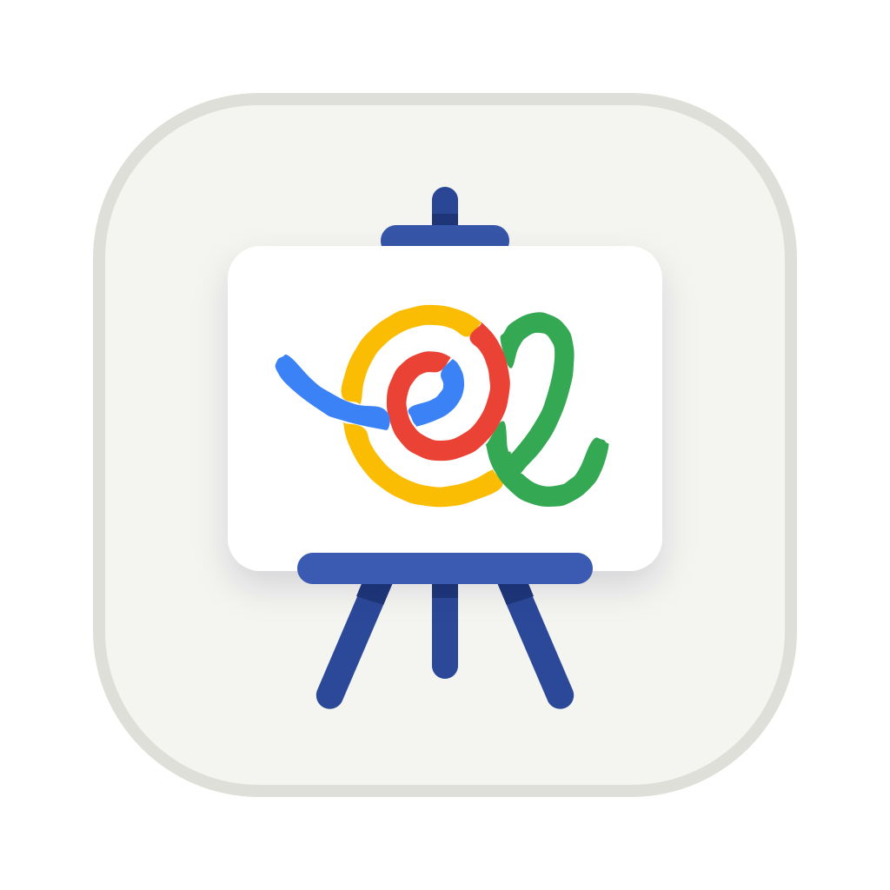
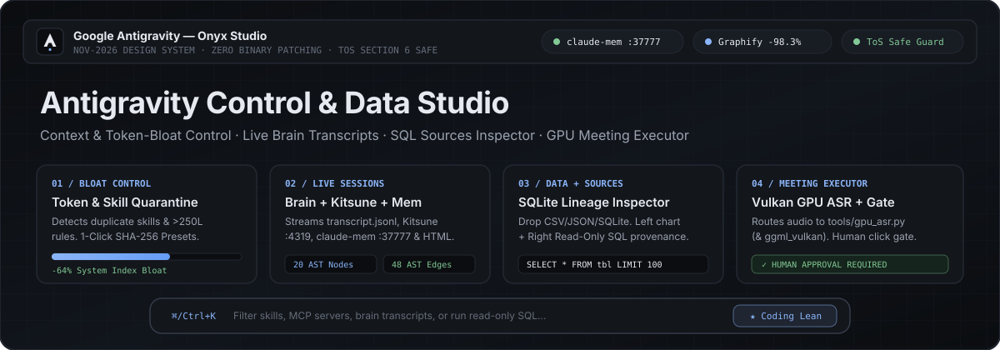

<div align="center">



# Google Antigravity：实时数据看板、上下文控制与动态演示工作台

**[English](../README.md) | [简体中文](./README.zh-CN.md) | [Português](./README.pt-BR.md)**

基于 `antigravity.google` 官方视觉体系构建的本地独立工作台：用于构建实时交互式看板、隔离重复 Skill 与上下文膨胀、审查只读 SQLite 数据溯源，以及通过 Vulkan GPU 语音转写执行会后人工审批。

<br />



</div>

---

## 代码即演示，数据可溯源 (Built as Code, Grounded in Local Sources)

本项目融合了 **Claude Dashboards & Motion** (`claude.com/resources/articles/dashboards-and-motion`) 与 **Claude Code Dashboards** 的核心交互范式，并通过 `/REA` 逆向工程完全复刻了 **`https://antigravity.google/`** 的真实视觉变量、字体系统与鼠标引力场物理动效。

工作台中的每一个指标、图表与待执行 MCP 动作都会透明展示其对应的 Windows 本地路径与只读 SQLite 查询语句，确保所有数据在汇报或执行前均可交叉验证。

* **零二进制修改 (符合 ToS 第 6 条安全规范)**：作为独立的本地 Web 服务运行（后端 `Hono` 监听 `:4320`，前端 `Vite / React 19` 监听 `:5175`）。内置 `assertNeverTouchesOfficialBinaries()` 硬件级守卫（位于 [server/paths.ts](../server/paths.ts)），**绝不触碰或修改** `~/.gemini/bin/agy.exe` 及任何 `.asar` 官方二进制包，零封号风险。

---

## 通过 `/REA` 从 `antigravity.google` 提取的真实视觉系统

| 视觉维度 / 子系统 | 提取自生产环境的真实参数 | 在本工作台中的应用 |
| :--- | :--- | :--- |
| **主标题与界面字体** | `Google Sans Flex` (`ROND 40, opsz 8..144`) | 页面主标题、指标卡片与交互式舞台切换器。 |
| **代码与 SQL 字体** | `Google Sans Code` (`wght 400..700`) | 本地文件路径、`transcript.jsonl` 日志、Token 计数与 SQL 语句。 |
| **官方图标字体** | `Google Symbols` (`ROND 50, opsz 24`) | 原生 Google 符号字体，彻底替代千篇一律的通用 AI 图标库。 |
| **深色主题表面色板** | `--palette-grey-1200` (`#121317`), `#18191d`, `#212226` | 默认深色工作台背景与多层级的卡片表面。 |
| **浅色社论主题色板** | `--palette-grey-10` (`#F8F9FC`), `--palette-grey-0` (`#FFFFFF`) | 支持在顶部导航栏一键切换高对比度浅色社论风格。 |
| **鼠标引力场胶囊粒子** | 移植自 `MainParticlesComponent.Cr9vcqqS.js` | 泊松盘分布的微胶囊粒子群 (`#7189ff`, `#3279f9`, `#f84242`, `#ffcf03`)，以 2% 帧插值跟随鼠标光标产生引力环推斥与角度偏转。 |

---

## 四大交互式舞台 (Four Interactive Stages)

### 舞台 01：上下文与 Token 膨胀控制中心 (Context & Bloat Control)
当 `~/.gemini/config/skills` 与插件目录（如 `SuperAntigravityTJTO`、`science`）中积累了重复的同名 Skill 或超过 250 行的规则文件时，系统提示词索引会超出预算上限，导致 Antigravity 静默剔除关键子代理（`browser`、`research`、`super-render`、`ultimate-research`）。
* 直接扫描全局 Skill、插件 Skill、内置 Skill、`GEMINI.md`、`AGENTS.md` 与 `mcp_config.json`。
* 自动高亮超过 `250 行` 的规则文件与跨目录重复注册的 Skill。
* **一键原子化预设**（`Coding Lean`、`Frontend Craft`、`Journalism & TJTO`、`Video / B-Roll`、`Full Restore`）：每次切换前自动对 `mcp_config.json` 生成 SHA-256 校验快照，并将冗余 Skill 安全移入 `backups/quarantine_skills/` 隔离区。

### 舞台 02：实时 Brain 会话、Kitsune 路由与十亿级上下文引擎
* 实时解析 `~/.gemini/antigravity/brain/<id>/.system_generated/logs/transcript.jsonl` 中的思考步骤与工具调用。
* 实时探测本地守护进程：**Kitsune Router** (`127.0.0.1:4319`)、**claude-mem 持久记忆库** (`127.0.0.1:37777`) 与 **MJ Notch Companion** (`127.0.0.1:49211`)。
* 读取 `.graphify.json`（`Graphify + PonyTail` AST 语法树索引：20 个文件，48 条依赖边）与 `PROJECT_MAP.md`（`Cartographer` 静态符号图谱：相比盲扫节省 `98.3%` Token）。
* 内置沙盒预览器，直接渲染 `/generative_ui` 生成的本地 HTML 工件。

### 舞台 03：实时数据看板与只读 SQL 溯源面板 (Data + Sources Inspector)
* 支持直接拖拽本地 `.csv` 或 `.json` 文件，利用 Node v26 原生 `node:sqlite` (`DatabaseSync`) 在内存中自动建表并推断字段类型。
* **左侧看板舞台**：实时渲染水平分布图与可滚动数据表。
* **右侧 Sources 溯源面板**：透明展示原始文件路径、推导出的字段 Schema、确定性转换步骤，以及受 `assertReadOnlySelectSql()` 保护的交互式 SQL 编辑器（仅允许单条 `SELECT` 或 `WITH` 查询，拦截一切修改或注入指令）。

### 舞台 04：会后任务 Vulkan GPU 执行器 (Post-Meeting Executor)
* 上传会议音频（`.wav`、`.mp3`、`.m4a`）直接调用本地 `tools/gpu_asr.py` (`ggml_vulkan` GPU 硬件加速) 转写，或直接粘贴会议记录。
* 自动提炼执行摘要、已确认决议与待执行的 MCP 载荷（写入 `claude-mem` 或 `sqlite`）。
* **强制人工审批门禁 (Human Approval Gate)**：所有生成的 MCP 动作默认锁定在 `PENDING_HUMAN_APPROVAL` 状态，必须由操作员手动点击 **Approve & Trigger MCP** 后才会真正派发并记录审计回执。

---

## 快速开始 (Quickstart)

环境要求：**Node.js v22.5+**（已在 `v26.13.1` 原生 `node:sqlite` 下完整验证）与 **Python 3.12+**（可选，用于 `gpu_asr.py` Vulkan GPU 语音转写）。

```powershell
# 1. 安装依赖包
npm install

# 2. 运行 Vitest 安全与变异测试套件 (6/6 通过)
npm test

# 3. 启动后端 API (:4320) 与前端工作台 (:5175)
npm run dev
```

在浏览器中访问 `http://localhost:5175`。
